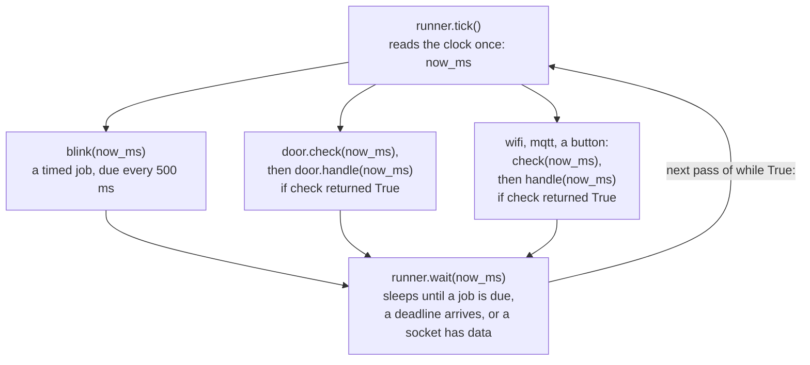

# How it works

A ChuMicro program is the `while True:` loop that board tutorials teach, with the `time.sleep()` calls taken out.  Each library in the program takes a short turn inside that loop and hands it straight back.  One board blinks an LED, reads a button, and holds a WiFi connection that way, all at once.  A deploy command on your laptop copies the program and its libraries onto the board.  The board runs the loop until the power goes.

The programs on this page print words where a real project would drive pins, so each one runs unchanged on CircuitPython, on MicroPython, and on the Python on your laptop.  [Coming from Arduino](coming-from-arduino.md) builds the same ideas with a real LED and button.

## One line at a time

```python
import time

while True:
    print("blink")
    time.sleep(0.5)
```

Python on a board runs a program one line at a time.  `time.sleep(0.5)` is a line that takes half a second to finish.  No other line runs until it does.  A button pressed and released inside that half second goes unseen.  A message from the network waits for the sleep to end.

Every job added to this loop brings its own sleep.  Each sleep holds up every other job.

## Check the clock instead of sleeping

```python
from chumicro_timing import Rate, ticks_ms

blink = Rate(500, ticks_ms())    # due every 500 ms, counting from now

while True:
    now_ms = ticks_ms()          # read the clock
    if blink.due(now_ms):        # is it time yet?
        print("blink")
```

`ticks_ms()` reads the board's millisecond clock, like Arduino's `millis()`.  `blink.due(now_ms)` answers `True` once every 500 ms and `False` on every other pass of the loop.  No line waits, so the loop comes straight back round.  A job added below the `if` gets a turn on every pass, between blinks as well as on them.

The [timing guide](https://chumicro.com/ChuMicro/timing/stable/guide/) covers `Rate` and its one-shot partner, `Deadline`.

## A library takes one small step per pass

`Rate` answers one question.  A WiFi connection is a job that never ends: join the network, notice when the router drops, pause, and join again.  Written with `time.sleep()` and a connect call that waits, that job holds the loop for seconds at a time.

A ChuMicro library splits a job like that into small steps.  Its object has two methods for the loop to call:

- `check(now_ms)` returns `True` when the object has work to do right now.
- `handle(now_ms)` does one small piece of that work and returns.

An object with these two methods is a *service*.  `DoorWatcher` below is a service that watches a door.  It lives in its own file, `door.py`, the way a library does:

```python
class DoorWatcher:
    """Print a line each time the door opens or shuts."""

    def __init__(self):
        self.is_open = False

    def read_door(self, now_ms):
        # A pretend door: open for 3 seconds, then shut for 3.
        # On a board, return your door switch's pin value here.
        return now_ms // 3000 % 2 == 1

    def check(self, now_ms):
        return self.read_door(now_ms) != self.is_open    # has the door moved?

    def handle(self, now_ms):
        self.is_open = not self.is_open
        print("door open" if self.is_open else "door shut")
```

Save `door.py` beside the program that imports it.  On a board, both files go in the board's top folder, next to each other.

The loop asks the door the same way it asks the blink timer:

```python
from chumicro_timing import Rate, ticks_ms

from door import DoorWatcher

blink = Rate(500, ticks_ms())
door = DoorWatcher()

while True:
    now_ms = ticks_ms()
    if blink.due(now_ms):
        print("blink")
    if door.check(now_ms):       # anything to do?
        door.handle(now_ms)      # do one small piece of it
```

The blink and the door share the loop because neither one waits.

`Button`, `WifiService`, `MQTTClient`, and `HttpClient` all have the same two methods.  `Button.check()` collects the presses and releases since the last pass.  `Button.handle()` calls your `on_press` function for a press.  `WifiService.check()` returns `True` when a join is due, a join is under way, or the link has dropped.  `WifiService.handle()` then takes the next step: it starts a join, or it looks at whether the join under way has landed.

A few steps still wait inside the firmware, such as a WiFi join on CircuitPython.  [Does anything ever block?](faq.md#does-anything-ever-block) lists them.

## A runner calls every job for you

A loop with five services holds five `if ... check(now_ms):` lines.  That loop never rests either: between due times the processor runs it flat out and finds nothing to do.  A `Runner` from `chumicro_runner` keeps the list of jobs and puts the board to sleep between them.

```python
from chumicro_runner import Runner

from door import DoorWatcher


def blink(now_ms):
    print("blink")


runner = Runner()
runner.add_periodic(blink, period_ms=500)   # a timed job: every 500 ms
runner.add(DoorWatcher(), period_ms=50)     # a service: look at the door every 50 ms

while True:
    now_ms = runner.tick()     # run every job that is due
    runner.wait(now_ms)        # sleep until the next one is
```

`runner.add_periodic()` registers a plain function to run every `period_ms`.  `runner.add()` registers a service.  Its `period_ms` sets how often the runner calls the service's `check()`.

`runner.tick()` reads the clock once and calls `check()` on each service that is due.  Then it runs every timed job that is due, and the `handle()` of every service whose `check()` returned `True`, in the order they were added.  It hands every job the same clock reading, `now_ms`, and returns it.

`runner.wait(now_ms)` is the line where the program sleeps.  It works out when the next job falls due and sleeps until then.  A network service names its socket.  `wait()` wakes early when data arrives on that socket.  A service that has to run by a set time, such as a WiFi retry or an MQTT keepalive, reports that time from a third method, `next_deadline(now_ms)`.  `wait()` wakes in time for it.  [How `wait()` decides how long to sleep](https://chumicro.com/ChuMicro/runner/stable/guide/#how-wait-decides-how-long-to-sleep) has the full rules.



Each pass of the loop is one `tick()` and one `wait()`.  A job that is due gets one short turn in the pass.  A job that is not due waits for a later pass.  [`basic_handler.py`](https://github.com/ChuMicro/ChuMicro/blob/main/libraries/runner/examples/basic_handler.py) counts the passes and prints how few there are.

## Jobs that run in order: generator tasks

Some jobs are a sequence: connect, send a request, wait for the reply, close.  A generator task writes that sequence top to bottom, the way a `time.sleep()` program reads.  Each `yield from` line pauses the task and hands the loop back to the runner.  The runner resumes the task on the next line once its wait is over.  Every other job keeps its turns in the meantime.

`runner.add_generator()` registers a generator task.  [Generator tasks](https://chumicro.com/ChuMicro/runner/stable/guide/#generator-tasks) in the runner guide walks through the code.

## Where the laptop fits

The libraries run on the board.  The laptop holds your code, the tools that copy it over, and your tests.

1. **Write.**  A *workspace* is a folder on your laptop, cloned from the [workbench template](https://github.com/ChuMicro/ChuMicro-Workbench-Template).  Each program in it is a project at `projects/<name>/app.py`, with setup and the `while True:` loop inside a function named `run()`.
2. **Deploy.**  `python3 run.py deploy <name>` copies `app.py`, each library it imports, and your settings from `secrets.toml` onto the board.  It adds a `code.py` (CircuitPython) or `main.py` (MicroPython) that calls `run()`, then restarts the board.
3. **Run.**  The board runs that `code.py` or `main.py` every time it powers up, with the laptop or without it.  A board unplugged from the laptop and powered from a phone charger runs the same loop.
4. **Watch.**  `python3 run.py repl --tail 30` shows what the board prints for 30 seconds.  `python3 run.py deploy <name> --tail 30` deploys and then shows the output, in one command.

The code and settings stay on the laptop, under version control.  Each deploy makes the board match them.  [Deploys and file persistence](troubleshooting/deploys-and-file-persistence.md) lists what a deploy keeps on the board and what it removes.

The libraries also run on the laptop's own Python.  A test of a program's logic runs there with a fake clock and no board, as [Can I test my project without hardware?](faq.md#can-i-test-my-project-without-hardware) shows.

A workspace is optional.  The same code runs when copied to the board by hand, as `code.py` on the CIRCUITPY drive or `main.py` on a MicroPython board, with libraries installed by `circup` or `mip`.  [Installing libraries](install.md) covers that route.

## Where to go next

- [Start here](start-here.md) sets up a workspace and puts a blink on a real board.
- The [glossary](glossary.md) defines each term these pages use and links to the page that covers it.
- The [runner guide](https://chumicro.com/ChuMicro/runner/stable/guide/) covers timed jobs, services, and generator tasks in full.
- The [timing guide](https://chumicro.com/ChuMicro/timing/stable/guide/) covers `Rate`, `Deadline`, and the tick functions.
