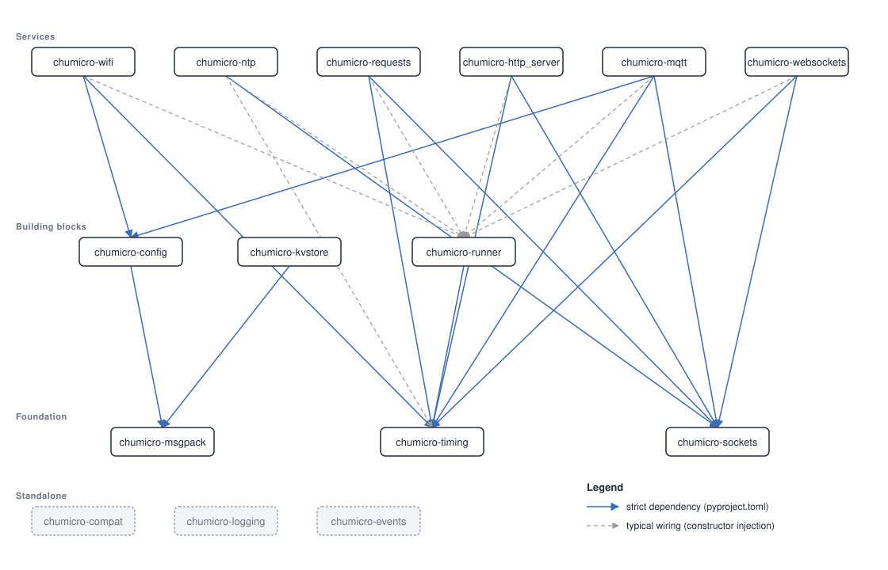

# ChuMicro libraries

These are small Python libraries for CircuitPython and MicroPython boards, each one installed by itself.  Every one also runs on your laptop's Python, so board code runs its tests at your desk.  The libraries that wait on something, such as WiFi, a server, or a button press, do their waiting a small step at a time inside your `while True:` loop.  [`runner`](runner/) gives each of them its turn in that loop.  The rest, such as `msgpack` and `compat`, are plain code you import and call.

 

A first project starts with [`timing`](timing/) for a loop that never sleeps.  [`buttons`](buttons/) and [`knobs`](knobs/) add input.  [`runner`](runner/) comes in once the loop has more than a couple of jobs or talks to a network.  The [project README](../README.md#three-steps-one-idea-each) walks that path one step at a time.  [Coming from Arduino](../docs/coming-from-arduino.md) maps `setup()`, `loop()`, and `time.sleep()` onto it.  The laptop tools that put these libraries on a board live in [`workbench/`](../workbench/).

## Pick a library

| Library | Use it when you need | What you get |
|---|---|---|
| **[timing](timing/)** | Something to happen every N milliseconds, or a time limit, without `time.sleep()` | `Rate` ("is it time yet?"), `Deadline` ("has the time run out?"), and tick math that survives the counter wrapping round. |
| **[runner](runner/)** | Several jobs in one loop, or any of the network libraries | A `Runner` that gives every service and timer its turn on `tick()` and rests the CPU on `wait()`.  Jobs that run in sequence can be written as generators. |
| **[buttons](buttons/)** | A button, switch, or key matrix that never misses a press | Debounced presses, long presses, auto-repeat, and click counts, captured in the background so a tap lands even while the loop is busy. |
| **[knobs](knobs/)** | A rotary encoder or a potentiometer that reads cleanly | Encoder steps counted outside your loop so a fast spin arrives whole, and analog readings that hold still instead of jittering. |
| **[wifi](wifi/)** | WiFi that joins, retries, and reconnects by itself | One `WifiService` for both runtimes, ESP32 and Pico W alike, with callbacks when the link comes and goes. |
| **[requests](requests/)** | To fetch a URL or call a web API | A non-blocking HTTP/1.1 client.  Your LED keeps blinking while the server answers, while the body downloads, and through a timeout. |
| **[http_server](http_server/)** | To serve web pages or an API from the board | An HTTP/1.1 server with `@server.route` handlers and path parameters.  The guide lists which runtimes serve TLS. |
| **[mqtt](mqtt/)** | To talk to an MQTT broker, the message hub most home-automation setups use | An MQTT 3.1.1 client with QoS 0 and 1, last will, retain, and TLS.  It stays connected while the loop does everything else. |
| **[websockets](websockets/)** | A live two-way connection to a browser or a server | WebSocket client and server, plain and TLS, that can share a board with `http_server`. |
| **[sockets](sockets/)** | A raw TCP, TLS, or UDP connection | Sockets that behave the same on CircuitPython, MicroPython, and your laptop.  The layer underneath the network libraries above. |
| **[ntp](ntp/)** | Your board needs the real time of day | The time from an NTP server, close enough to UTC for TLS certificate checks and honest log timestamps. |
| **[config](config/)** | Settings your program reads on the board at startup | Typed settings with one dotted-key naming scheme (`wifi.ssid`, `mqtt.broker.host`) that every library reads through its `<Name>Config.from_config(...)`. |
| **[kvstore](kvstore/)** | A value that survives a reboot | A small key-value store for counters, timestamps, and tokens.  It picks the storage your board has: NVM, NVS, or a file. |
| **[msgpack](msgpack/)** | To send or store data more compactly than JSON | Binary serialization that reads and writes the same bytes as PyPI's `msgpack` with `use_single_float=True`. |
| **[compat](compat/)** | A standard-library piece your board's Python lacks | Small stand-ins, such as `functools.partial`, so one file of code runs everywhere. |

[Board support](https://chumicro.com/ChuMicro/guides/install/#board-support) lists the boards these libraries have run on.

## Install

[The install guide](https://chumicro.com/ChuMicro/guides/install/) covers circup on CircuitPython, mip on MicroPython, pip on your laptop, the experimental channel, and pre-compiled `.mpy` packages.  Each library's own README has a one-line install command for that library.

## Dependencies

The libraries stack from the bottom up:

- **Timing and scheduling:** `timing`, `runner`.  Most of the others build on these.
- **Physical input:** `buttons`, `knobs`.
- **Settings, storage, and serialization:** `msgpack`, `config`, `kvstore`.
- **Networking:** `wifi` joins the network.  `sockets` opens TCP, TLS, and UDP connections over it.  `ntp`, `requests`, `http_server`, `websockets`, and `mqtt` speak their protocols over those sockets.

Solid arrows are hard dependencies: `pip install chumicro-mqtt` brings its dependencies along.  Dashed arrows are connections your program makes when it creates the objects.  Your program registers each networked service with a `Runner` and hands most libraries a clock.  The libraries at the two ends of a dashed arrow never import each other.

[`scripts/render_dep_graph.py`](../scripts/render_dep_graph.py) draws the graph from each library's `pyproject.toml`.
