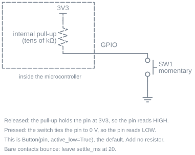
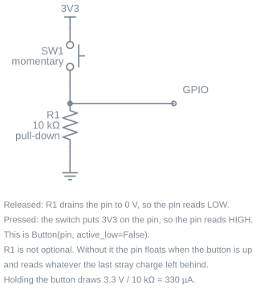
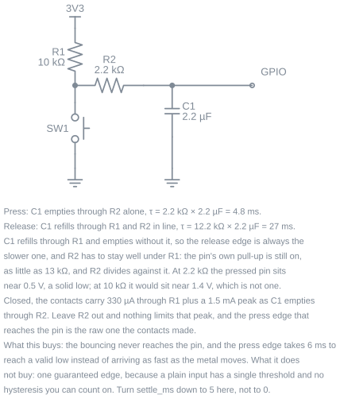

# User Guide

## Overview

A button is a pin that reads high or low.  Turning that into something a program can use takes more than one read: the contacts bounce, a quick tap can come and go between two passes of your loop, and "held for two seconds" is a different event from "pressed".

`chumicro_buttons` does that work.  `Button` reads one button or switch, `Buttons` reads several on one scan, and `KeyMatrix` reads a keypad wired as rows and columns.  All three give you the same readings, so code written for one button works unchanged for twelve.

If you have used `adafruit_debouncer`, `check()` is its `update()`, `just_pressed` is its `Button.pressed`, and `pressed` here is the held-down level, true for as long as the button is down.  If you have used Arduino's Debounce sketch, the `lastDebounceTime` bookkeeping happens inside `check()`.

## Getting started

Wire a momentary button from GP14 to GND on a Pi Pico W.  The pin's internal pull-up is switched on for you, so the button is the only part.

```python
import board
from chumicro_buttons import Button
from chumicro_timing import ticks, ticks_ms

button = Button(pin=board.GP14, ticks=ticks)    # ticks: the clock it times presses with

while True:
    now = ticks_ms()
    button.check(now)               # collect what the button did; never waits

    if button.just_pressed:         # True on exactly one pass per press
        print("pressed")
```

`check(now_ms)` collects whatever the button did since the last pass and updates the readings.  It never waits, so the rest of your loop keeps running.  `ticks=ticks` hands the button the clock module from `chumicro-timing`, which it uses to time debouncing and long presses; pass it as shown.

On MicroPython there is no `board` module.  Pass a `machine.Pin` instead, and everything else on this page reads the same:

```python
from machine import Pin

button = Button(pin=Pin(14), ticks=ticks)
```

Any pin that can read with a pull-up works.  On a Pico W that is every `GP` pin.  On an ESP32-S2 board GPIO 14 works too (`board.IO14` on CircuitPython), and GPIO 0 is the BOOT button already on the board.  On a classic ESP32, skip GPIO 34 to 39, which are input-only with no pull-ups.

## Wiring a button



Wire the button between the pin and GND.  `Button(pin=...)` switches the pin's internal pull-up on, which holds the pin high until the button pulls it low, so the button is the only part you need.  A pressed button reads low, which is why `active_low` defaults to `True`.

To wire the button to 3V3 instead, add your own pull-down resistor and pass `active_low=False`:



A 10 kΩ pull-down draws 330 µA while the button is held, which matters on a battery only if the button is held often.

## Reading the button

Every reading is a plain attribute that `check()` refreshes:

```python
button.pressed          # True while the button is down
button.just_pressed     # True only on the pass the press landed
button.just_released    # True only on the pass the release landed
button.held_ms          # how long it has been down, in milliseconds
```

The `just_` readings are true on exactly one pass of the loop.  You can read them from several places in that pass without them firing twice, and you never clear them.

`held_ms` keeps the length of the press that just ended, so code that runs on release can ask how long the button was held.  It starts again from zero on the next press.

`pressed` is the reading for a switch that stays where you put it: a toggle switch, a reed switch on a door, a slide switch picking a mode.  It is the same object, and the `just_` readings tell you when the switch moved.

## Long press, repeat, and clicks

Three timed events sit on top of the presses.  Long press is on by default at half a second; repeat and click counting stay off until you set them:

```python
button = Button(
    pin=board.GP14,
    ticks=ticks,
    long_press_ms=500,      # 0 turns long press off
    repeat_ms=200,          # 0 turns auto-repeat off
    repeat_delay_ms=700,    # how long to hold before repeat starts
    click_ms=250,           # 0 turns click counting off
)
```

A long press fires once per press, when the hold reaches `long_press_ms`:

```python
if button.just_long_pressed:
    factory_reset()
```

Auto-repeat is what a held arrow key does.  After `repeat_delay_ms`, `just_repeated` comes true every `repeat_ms` until the button is released.  The schedule counts from when each repeat was due, so a slow pass of the loop does not stretch it, and a long stall gives one catch-up repeat rather than a burst:

```python
if button.just_pressed or button.just_repeated:
    volume += 1
```

Click counting is how you tell a single click from a double click.  After each release it waits `click_ms` to see whether another press follows.  When none does, `just_clicked` comes true and `click_count` holds how many presses were in the run:

```python
if button.just_clicked:
    if button.click_count == 1:
        send_status()
    elif button.click_count == 2:
        wake_screen()
```

A press still reports `just_pressed` straight away; click counting adds a later event and delays nothing.  A press held longer than `click_ms` is a hold rather than a click and is left out of the count, which keeps a long press from also arriving as a single click.

## Callbacks

If you would rather be called than ask, set callbacks and let `handle(now_ms)` call them:

```python
button.on_press = lambda: print("down")
button.on_long_press = factory_reset
button.on_click = lambda count: print("clicked", count, "times")

while True:
    now = ticks_ms()
    if button.check(now):
        button.handle(now)
```

`check()` returns `True` when the pass produced anything, which is when `handle()` has something to do.  Your callbacks run in your own loop like any other code, so they can allocate, print, and raise.

## Several buttons

`Buttons` reads a group of buttons on one scan, which costs less than one scan per button and is what lets two buttons pressed together land on the same pass:

```python
from chumicro_buttons import Buttons

buttons = Buttons(pins=(board.GP14, board.GP15, board.GP16), ticks=ticks)

while True:
    now = ticks_ms()
    buttons.check(now)

    if buttons[0].just_pressed:
        print("first button")

    if buttons[1].pressed and buttons[2].pressed:
        print("both held together")
```

Each `buttons[index]` is a `Button` with its own readings and callbacks, numbered in the order you gave the pins.  For one handler covering the whole group, `Buttons` has its own callbacks that receive the button's number:

```python
buttons.on_press = lambda key_index: print("button", key_index, "down")
```

## A keypad matrix

A keypad wires its keys as a grid of rows and columns, so twelve keys need seven pins instead of twelve.  `KeyMatrix` reads that grid and hands you the same `Button` objects.

Import it from its own module, which keeps it off boards that only have separate buttons:

```python
from chumicro_buttons.matrix import KeyMatrix

keypad = KeyMatrix(
    row_pins=(board.GP2, board.GP3, board.GP4, board.GP5),
    column_pins=(board.GP6, board.GP7, board.GP8),
    ticks=ticks,
)

while True:
    now = ticks_ms()
    keypad.check(now)

    if keypad[0].just_pressed:
        print("top-left key")
```

Keys are numbered across each row in turn, so the key at `row`, `column` is `row * len(column_pins) + column`.  With the three columns above, key 4 is row 1, column 1.

CircuitPython scans the grid in the background, so a tap between two passes of your loop still lands.  MicroPython scans once per `check(now_ms)`, because a grid has to be driven a row at a time, so a loop that stalls for long stretches can miss a very short tap on a matrix key.  Separate buttons have no such limit on either runtime.

### Wiring the keypad

A ready-made membrane keypad brings its grid out as one row of header pins, rows and columns mixed.  Wire them to pins that can both read with a pull-up and drive an output: every `GP` pin on a Pico W qualifies, and on a classic ESP32 skip GPIO 34 to 39, which can do neither.  On MicroPython pass `machine.Pin` objects, as for a single button.

A membrane keypad has no diodes inside, so its rows and columns are interchangeable.  Which pins you call rows decides only which way the numbering runs: a keypad that numbers its keys down the columns wants its two tuples swapped, not rewired.  If the header is unlabelled, press each key in reading order and note which two pins connect.  The pin shared by every key in the first row is your first row pin, and the pins it pairs with are your column pins, in order.

A grid without diodes cannot read three keys at once: three pressed keys at three corners of a rectangle make the fourth corner read as pressed too.  That comes from the wiring, not the library, and it is why keyboards built for chords carry a diode per key.  On a grid with diodes, `columns_to_anodes` tells the scan which way they face; leave it `True` when each diode's striped end points at a row pin.  A wrong guess damages nothing, and a diode keypad that reports no keys at all is the sign to flip it.

## Runner pattern

`check(now_ms)` and `handle(now_ms)` are the two methods [`chumicro-runner`](https://github.com/ChuMicro/ChuMicro/tree/main/libraries/runner) calls on every service, so a button joins the rest of your program with one line:

```python
from chumicro_runner import Runner

button.on_press = lambda: print("pressed")
button.on_long_press = factory_reset

runner = Runner()
runner.add(wifi)
runner.add(button, period_ms=20)    # look at the button every 20 ms

while True:
    now = runner.tick()
    runner.wait(now)
```

`runner.tick()` reads the clock once and calls `check` on each service that is due, then `handle` on the ones with news, so a program built on callbacks never reads the `just_` readings at all.  Every service sees the same time, so the button's idea of "now" matches the rest of the program.

`runner.wait(now)` rests the CPU until the next job is due.  A press is a change on a pin, not a timer, so it cannot wake the runner.  `period_ms=20` makes the button a job that comes due every 20 ms, which caps how long a press waits to be reported.  Leave it off and the button is checked only when something else wakes the runner: in a busy program that is constantly, and in a quiet one with a five-second job it is every five seconds.

A press that lands while the runner rests is still captured with its real time, so the period decides only how soon you hear about it, not whether you do, and `held_ms` counts from the real press either way.  The same holds when another service is slow inside its own `handle`, a network handshake for example: the press is captured underneath and its callback runs on the pass that follows.  Long presses, repeats, and the end of a click run are checked on the same 20 ms schedule, so each fires within 20 ms of when it is due.

## Tuning the debounce

A button's contacts bounce for a moment when they meet.  A small tactile button settles in one to five milliseconds; a bigger toggle switch or microswitch can take twenty.  Left alone, one press arrives as several.

`settle_ms` is the only debounce setting, and it defaults to 10:

```python
button = Button(pin=board.GP14, ticks=ticks, settle_ms=10)   # the default
button = Button(pin=board.GP14, ticks=ticks, settle_ms=20)   # a switch that bounces badly
button = Button(pin=board.GP14, ticks=ticks, settle_ms=0)    # the signal is already clean
```

A change counts once the pin has held its new level for `settle_ms`, and it is timed from the moment the pin changed, not from the moment the change became certain.  Durations therefore measure the press the person made, however late your loop gets back to it.

`settle_ms` is also the shortest press the library can report.  A tap shorter than the window never holds its new level long enough to count, so it is thrown away with the bounce, and nothing tells you.

Measured on a Pi Pico W with a button that has no debounce hardware, 30 seconds of tapping as fast as a finger goes closed the contacts 107 times.  Thirty of those taps were shorter than 20 ms and seven were shorter than 10 ms, so a 20 ms window would have dropped more than a quarter of them and the 10 ms default drops about six in a hundred.  That measurement is why the default is 10 rather than 20.

Pick the window from what the button is for:

| `settle_ms` | Good for | Drops taps shorter than |
|---|---|---|
| 20 | A toggle, a microswitch, or any big switch that bounces badly | 20 ms, about a quarter of fast tapping |
| 10 (default) | A tactile button, which is most buttons | 10 ms, about six taps in a hundred |
| 5 | Fast tapping or a game control, on a button you have measured | 5 ms, which a finger rarely reaches |
| 0 | Debouncing hardware behind the pin, or a signal already clean | nothing |

On a big switch, a gap of more than 10 ms in the middle of the bouncing can count as a real change, which is the case for raising the window to 20.

### Adding a capacitor

Software debouncing is enough for almost every project.  A capacitor at the pin earns its place when the wire to the button is long enough to pick up noise, or when the button feeds something you do not control.



The capacitor slows both edges so the bouncing never reaches the pin.  It slows them unequally: it refills through the pull-up but empties through the series resistor alone, which works out to 4.8 ms on press and 27 ms on release.

The series resistor does two jobs.  It limits the current through the contacts when the capacitor empties into them, and it has to stay well below the pull-up, because the pin's own pull-up is still switched on and forms a divider with it.  At 2.2 kΩ the pressed pin sits near 0.5 V, a solid low.  At 10 kΩ it would sit near 1.4 V, which is not a low at all.

With the capacitor in place, turn `settle_ms` down to 5 but not to zero.  A plain input pin switches at one threshold with no margin you can rely on, so a slow edge passing through it can still flicker, and the settle window catches that.  A bigger capacitor makes it worse, because the edge spends longer near the threshold.

## Presses land even when the loop is slow

If your program is busy with a network request or a flash write when a tap happens, a plain pin read looks too late and the press is gone.  This library captures the press when it happens, not when you get round to asking.  On CircuitPython that is the firmware's background scan; on MicroPython the library installs a small pin interrupt.  You set none of it up, and there is no capture mode to choose.

What you can see is that durations count from the real press:

```python
button.check(now)
if button.just_pressed:
    print(button.held_ms)      # already above zero if your loop was busy
```

A press at 100 ms that a busy loop notices at 180 ms reports 80 ms held, not 0.

When a signal is so noisy that capture cannot keep up, `button.overflowed` comes true for that pass.  An ordinary button never does this.  If yours does, the capacitor above is the fix.

## Memory notes

`check()` allocates no memory once the program is running.  Presses are collected through a buffer made when the button is built, the readings are attributes updated in place, and the loops count by hand rather than building iterators.  A program can check a button forever without the heap growing.

On MicroPython the capture buffer is sized when the button is built to hold the burst of edges a bouncing contact produces.  If `overflowed` comes true on an ordinary press, the button bounces harder than that, and the capacitor in [Adding a capacitor](#adding-a-capacitor) fixes it at the source.

## Testing

`chumicro_buttons.testing.FakeButtonSource` stands in for the hardware, so press logic is an ordinary unit test with no board and no waiting:

```python
from chumicro_buttons import Button
from chumicro_buttons.testing import FakeButtonSource
from chumicro_timing.testing import FakeTicks


def test_hold_arms_the_reset():
    source = FakeButtonSource()
    button = Button(source=source, ticks=FakeTicks(), long_press_ms=3000)

    source.press(at_ms=100)
    button.check(100)
    button.check(3200)

    assert button.just_long_pressed
```

Each queued press or release carries its own `at_ms`, separate from the time you pass to `check()`, which is how a test covers a slow loop on your laptop.  The [testing page](testing.md) goes further, including pressing two buttons together and the overflow case.

## Platform notes

| Runtime | How presses are captured |
|---|---|
| CircuitPython | The firmware's `keypad` module, which scans in the background and stamps each press with the time it happened |
| MicroPython | A pin interrupt the library installs and owns; your code never runs inside it |
| CPython | No pins exist, so `pin=` raises and points you at `FakeButtonSource` |

The code you write is identical on all three.  On CircuitPython the `keypad` module is built into the firmware, so it takes no space on your board's drive.

## Examples

| Example | What it shows |
|---|---|
| [`circuitpython_button_toggle.py`](https://github.com/ChuMicro/ChuMicro/blob/main/libraries/buttons/examples/circuitpython_button_toggle.py) | A press flips the onboard LED and a half-second hold turns it off, on CircuitPython (needs a board) |
| [`micropython_button_toggle.py`](https://github.com/ChuMicro/ChuMicro/blob/main/libraries/buttons/examples/micropython_button_toggle.py) | The same program on MicroPython (needs a board) |

---

<div class="chumicro-footer" markdown>

[← Home](index.md)

[Source](https://github.com/ChuMicro/ChuMicro/tree/main/libraries/buttons) · \
[PyPI](https://pypi.org/project/chumicro-buttons/) · \
[Bundle](https://github.com/ChuMicro/ChuMicro-Bundle) · \
[Experimental Bundle](https://github.com/ChuMicro/ChuMicro-Bundle-Experimental)

</div>
